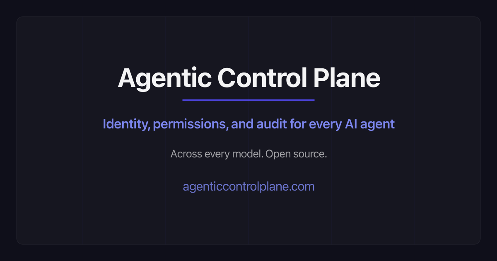
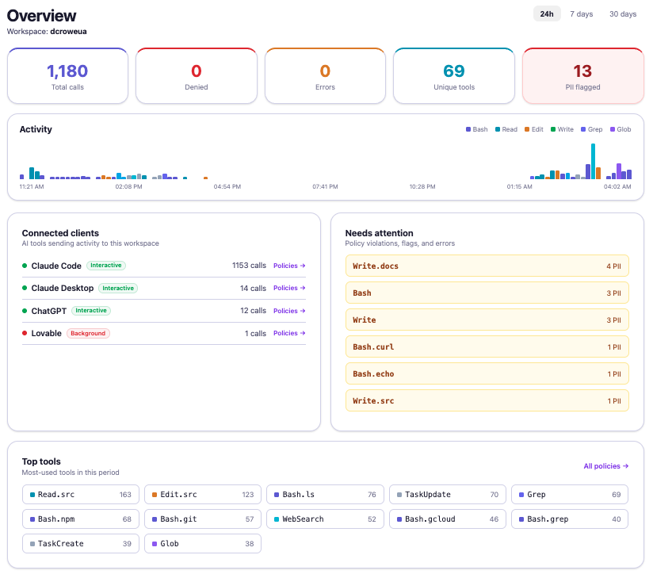

<p align="center">
  
</p>

<h1 align="center">Agentic Control Plane</h1>

<p align="center"><strong>One set of allow / ask / deny rules and one log for every coding agent you run.</strong></p>

<p align="center">
  <a href="https://agenticcontrolplane.com">Website</a> ·
  <a href="https://cloud.agenticcontrolplane.com/login">Live dashboard</a> ·
  <a href="https://agenticcontrolplane.com/docs">Docs</a> ·
  <a href="https://agenticcontrolplane.com/trust">Trust &amp; security</a> ·
  <a href="https://agenticcontrolplane.com/contact">Contact</a>
</p>

---

ACP sits in the call path between your coding agent and its tools. Before a tool runs, a hook asks ACP whether to allow it, ask you first, or deny it. Every call is logged, so you can see who ran what. In a connected workspace, model calls made through the `*-acp` launchers are priced too.

One command installs it for Claude Code, Codex, Cursor and the other coding agents it finds on your machine. No code changes.

The recording below runs 60 seconds: one command, no account, and the same policy applied to Claude Code and Codex.

<p align="center">
  
</p>
<p align="center"><sub>Recorded from the live installer and the real CLIs. <a href="https://github.com/agentic-control-plane/acp-install/tree/main/demo">How it's made</a>.</sub></p>

We run our own production agents through it. This is a real workspace:

<p align="center">
  
</p>

## Install

```bash
# Free, on-device, no account. Runs entirely on your machine:
curl -sf https://agenticcontrolplane.com/install.sh | bash -s -- --local
```

The installer finds the coding agents you run and adds a policy hook to each. Nothing leaves your machine at run time; the installer downloads the hook once. `--local` covers Claude Code, Cursor, Codex, OpenClaw, Qwen Code and Copilot. Hermes, dsh, pi, Prime Agent, Muse Code, Grok Build, Antigravity and opencode need a workspace, so `--local` skips them. Drop `--local` to connect a workspace instead (shared policy, cost X-ray, one console for everyone's agents).

Other ways in:

- **Framework agents** (LangGraph, CrewAI, Vercel AI SDK, OpenAI Agents): install a package and wrap your tools.
- **MCP clients** (ChatGPT, Claude Desktop): add `https://api.agenticcontrolplane.com/mcp` as a connector.
- **Anything else**: call the policy API directly with a bearer token.

## What it does

- **Logs every tool call as it happens:** who triggered it, which agent, what it returned and how long it took. Filter and export. In a connected workspace, the cost X-ray prices model calls and splits each run into the orchestration loop and the leaf steps, so you can see which step is the bill. Per-agent p50/p95 run variability shows which agent is flaky.
- **Applies your rules per tool:** each one is allow, ask first, or never. A small safety floor is on by default: `rm -rf /`, `mkfs` and fork bombs are always refused, and force-push, destructive SQL through a database CLI, `curl | sh` and deletes outside the project ask first. The check runs in a hook outside the model, so a prompt can't talk the agent past it. If hooks are switched off on the machine, it doesn't run.
- **Delivers holds:** on Claude Code a floor hold is a prompt in the session. On other harnesses the call is blocked, you approve it in the console or by email, and the agent retries.

## Why this rather than auto mode plus a sandbox

Keep both. A sandbox limits where the agent can write and what it can reach. Auto mode uses a classifier to decide each call, and it blocks force-push and `curl | bash` by default. Both are per harness, and neither is your own rule set. ACP adds one set of allow / ask / deny rules and one log across Claude Code, Codex and the rest, and the safety floor runs in a hook outside the model.

If ACP is unreachable, interactive sessions go ahead with a loud UNGOVERNED notice, and the safety floor still runs on the machine. Unattended sessions (background, subagent, API) stay blocked until the gateway answers. It's the same hook on every harness; only the bundled fallback hook, used when GitHub can't be reached at install time, always fails open. [Details](https://agenticcontrolplane.com/trust).

## Open source

The plugins, the on-device engine and the GatewayStack modules are MIT licensed. You can read them and run them yourself. The hosted gateway, dashboard, team management and cost X-ray are closed source. Self-hosting the full gateway is an Enterprise option. [Details](https://agenticcontrolplane.com/trust).

| Repo | What it is |
|------|------------|
| [**acp-install**](https://github.com/agentic-control-plane/acp-install) | One-command installer. Policy hooks and MCP connectors for coding agents and MCP clients. |
| [**claude-code-acp-plugin**](https://github.com/agentic-control-plane/claude-code-acp-plugin) | The Claude Code plugin. |
| [**codex-acp-plugin**](https://github.com/agentic-control-plane/codex-acp-plugin) | The Codex CLI plugin. |
| [**agent-audit**](https://github.com/agentic-control-plane/agent-audit) | Reads your local Claude Code and Codex session logs and lists force-pushes, destructive commands and leaked secrets. Read-only. |
| [**hermes-acp-plugin**](https://github.com/agentic-control-plane/hermes-acp-plugin) | Native Python plugin for Nous Research's Hermes Agent (`pip install acp-hermes`). |
| [**acp-governance-sdks**](https://github.com/agentic-control-plane/acp-governance-sdks) | TypeScript and Python SDKs for scoped subagents and delegation chains. |
| [**delegation-chain-spec**](https://github.com/agentic-control-plane/delegation-chain-spec) | ADCS, an open spec for agent-to-agent delegation: scope narrowing, a human at the root of every chain, per-hop scope intersection. |
| [**agentgovbench**](https://github.com/agentic-control-plane/agentgovbench) | A 48-scenario benchmark for identity, policy and audit across agent frameworks. We wrote it and score ourselves on it. |
| [**acp-pr-reviewer-demo**](https://github.com/agentic-control-plane/acp-pr-reviewer-demo) | A PR reviewer that delegates to scoped sub-agents, with every hop audited. |
| [**GatewayStack**](https://github.com/agentic-control-plane/GatewayStack) | The open core: identity, policy, limits, routing, PII redaction and audit as npm modules. |

There is one plugin repo per harness (`openclaw-acp-plugin`, `pi-acp-plugin`, `grok-build-acp-plugin` and so on). The [coverage matrix](https://agenticcontrolplane.com/coverage) says what each one sees and how a held call reaches you.

## Who the agent is acting for

A backend sees a service token, not the person the agent works for, so it can't tell who the agent is acting for, whether the action was authorized, or what it cost. ACP checks at the tool call, where that context still exists. [The longer argument](https://agenticcontrolplane.com/what-is-an-agentic-control-plane).

## Pricing

Free for up to 5 initiating agents, with unlimited calls and free subagents. Team is $100 a month for up to 25 agents, Scale is $1,000 a month for up to 250, and Enterprise is by quote (SSO, self-host, compliance exports). [Pricing](https://agenticcontrolplane.com/pricing).

## Contact

[Blog](https://agenticcontrolplane.com/writing) · [Trust & security](https://agenticcontrolplane.com/trust) · [Security disclosure](https://agenticcontrolplane.com/.well-known/security.txt) · [GitHub Discussions](https://github.com/orgs/agentic-control-plane/discussions) · [Community](https://agenticcontrolplane.com/community)

<p align="center"><sub>© Reducibl · <a href="https://agenticcontrolplane.com/privacy">Privacy</a> · <a href="https://agenticcontrolplane.com/terms">Terms</a></sub></p>
